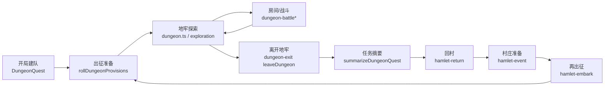

# I 级任务全流程断点清单（2026-10-27）

> **范围**：只盘点、不修代码。对照仓库 `main`（本地 HEAD `d1d3086`，含 #307 R-120 Boss 任务数据接线；交接 tip `6d6f5ce` 为 R-121/R-122 语义，本清单不重做 tip）。
> **目标闭环**：开局 → 建队/出征 → 地牢探索 → 战斗 → 撤离/失败 → 回村结算 → 存档读档 → 再出征（战役 I 级）。
> **规则约束**：R-001（只认规则书 + `docs/rulings.md`）；R-048（不自发明印刷几何/未核实图标）。拿不准标「待确认」。

---

## 1. I 级可出征任务与入口

### 1.1 战役出征池（`questsForCampaignLevel(1)`）

引擎与数据层对 **I 级普通任务** 的正式池定义在 `packages/data/src/basic-quests.ts`（`questsForCampaignLevel` 排除 `bossQuest`）。当前 **5 张**：

| 任务 ID | 名称 | 数据/印刷 | 战役池 | 自然命令路径测试 | 备注 |
|---------|------|-----------|--------|------------------|------|
| `quest:p001` | Scout Ahead I | enabled（`quest-print-art-map.json`） | 是 | 有（`natural-quest-paths.test.ts` seed1） | 主线黄金路径首选 |
| `quest:p002` | Wipe ‘Em Out I | enabled | 是 | 有（seed1） | 巢穴 XP |
| `quest:p003` | Fundraiser I | enabled | 是 | 有（seed3） | 捐献待选 |
| `quest:p004` | Dem Bones I | enabled | 是 | **无** | `xpKind: objective`，含 3×Objective 代币 |
| `quest:p005` | Rising Threat I | enabled | 是 | **无** | `xpKind: curio`，3×Curio 代币 |

- **任务语义与分布 JSON**：均已写入 `basic-quests.ts` + `packages/data/normalized/corebox/*_distribution.json`，本清单不重复裁定。
- **QuestMap**：八槽 I 级任务出征时 `pickEmbarkQuestMapLayout` 优先 `review: confirmed` 布局；目前仅 **`quest_map:p001`** 为 confirmed（`dungeon_layouts.json`），p004/p005 与 p001–p003 共用该图，不表示 p004/p005 专用图已批。

### 1.2 玩家入口路径（Web）

| 路径 | URL / 组件 | 适用任务 | 说明 |
|------|------------|----------|------|
| **正式主路径（默认）** | `/` → `App.tsx` → `DungeonQuest` | 沙盒列表内可选的 I 级 + Boss 卡 | 建队 → 出征准备 → `createCoreDungeonQuest` → `DungeonSandbox formal` + `TabletopFormalShell` |
| 出征准备任务列表 | `sandboxEmbarkQuests()`（`dungeon-quest.tsx`） | `level === 1` **或** `bossQuest`（p016–p019） | **含 Boss 任务卡选项**；选 Boss 会触及 hold 项（见 §4），非 I 级战役池 |
| 战役「再出征」 | 村庄 `preparationComplete` → `offerNextQuest` → `resolveChoice` → `chooseNextQuest` | 仅 `questsForCampaignLevel(当前等级)` | UI：`hamlet-event-section.tsx` + `quest-summary-panel.tsx` 内 pending 按钮 |
| 任务存档 | `QuestSaveControls`（localStorage `ddbg.core-quest.save.v1`） | 当前进行中的任务 | 引擎 `createQuestSave` / `loadQuestSave`；`hamlet.spec.ts` 等覆盖回村后读写 |
| 旧版地牢沙盒 | `/?phase=3` → `DungeonSandbox`（非 formal） | 调试 | 布局与正式壳不同，**不作为主路径验收** |
| 桌面 Mock | `/?view=tabletop` → `TabletopView` | 无真实引擎 | `engineBridge.game === null`，**不构成可玩闭环** |

### 1.3 引擎 / 测试入口（非玩家 UI）

| 入口 | 符号 / 文件 | 覆盖 |
|------|-------------|------|
| 单任务真实入口 | `createCoreDungeonQuest`（`dungeon-quest-entry.ts`） | **全部 5 张 I 级**（`dungeon-quest-entry.test.ts` each level===1） |
| 自然路径回放 | `naturalQuest`（`test-helpers/natural-quest.ts`） | 仅 p001–p003 |
| 战役抽任务黄金池 | `GOLDEN_MAIN_CAMPAIGN_QUEST_IDS`（`golden-quest-pool.ts`） | 测试夹具仍收窄为 p001–p003，**不等于生产池只有三张** |

---

## 2. 主路径代码追踪（最短闭环）

下列顺序与正式 UI + 引擎命令一致；括号内为主要文件/符号。

| 阶段 | 流程相（`flow-phase.ts`） | 关键命令 / 状态 | 自动化覆盖 |
|------|---------------------------|-----------------|------------|
| 开局建队 | `questSetup` | 本地 React 状态 → `beginTask` | `home.spec.ts` |
| 出征准备 | `expeditionPrep` | `rollDungeonProvisions` | `formal-exploration.spec.ts`（仅进入探索） |
| 探索 | `dungeonExploration` | `scoutDungeon` / `beginDungeonExploration` / `resolveDungeonRoom` / 走廊骰 | 引擎大量单测；e2e 不跑完整清图 |
| 战斗 | `battle` | `prepareDungeonBattle` → `prepareDungeonMonsters` → `startDungeonBattle` | `formal-battle.spec.ts` |
| 撤离 | — | `leaveDungeon` → `phase: exited` | `natural-quest-paths`（p001–p003） |
| 摘要 | `questReturn` | `summarizeDungeonQuest` | 同上 |
| 回村 | `questReturn` | `beginReturnToHamlet` → `finishReturnToHamlet`（`awarded: true`） | `hamlet-return.test.ts`、`hamlet.spec.ts` |
| 村庄 | `hamlet` | `drawHamletEvent` → 看守人/建筑/… | `hamlet.spec.ts`（注入存档） |
| 再出征 | `hamlet` → `expeditionPrep` | `offerNextQuest` + `chooseNextQuest` | `hamlet-embark.test.ts`、`two-quest-guild` 夹具 |

**阶段流解析**：`resolveFlowPhase`（`apps/web/src/tabletop/phase/flow-phase.ts`）由 `dungeon.hamlet` / `hamletReturn` / `battle` / `awaitingProvisions` 驱动；正式壳 `TabletopFormalShell` 在回村/村庄阶段仍包一层，但中央内容回退到 `ScoutingPanel` / `quest-return-center`，**不是**探索期的 `FormalDungeonExplorationView`（`dungeon-sandbox.tsx` 中 `isFormalDungeonTabletopExploration` 为 false）。

---

## 3. 断点清单（按「先堵流程断」排序）

严重度：**阻塞** = 常见主路径无法继续；**可绕过** = 换种子/换任务/用手动命令或旧 UI 可能继续；**内容缺口** = 引擎/UI/文案不一致或缺抛光，不必然立刻卡死。

| # | 严重度 | 断点摘要 | 位置（文件 / 符号） | 复现路径（要点） | 影响闭环段 | 触及 hold |
|---|--------|----------|---------------------|------------------|------------|---------|
| B01 | **阻塞** | **Objective 房间无运行时**：进入 `objective` 代币房后 `awaitingRoom`，`beginDungeonRoom` 只接 Trap/Dark/Curio，无清理/交互；UI 无对应按钮 | `packages/engine/src/dungeon-room.ts` → `beginDungeonRoom`；`formal-tabletop-scouting-panel.tsx` 命令区仅 lair/treasure/trap/dark/curio | 正式入口选 **Dem Bones I** → 探索至 Objective 房 → 无「结算房间」且 `resolveDungeonRoom` 拒绝 | 探索 → 战斗/清房 → 摘要 XP（`xpKind: objective`） | 否 |
| B02 | **阻塞** | **部分房间战斗部署后仍无法 `startDungeonBattle`**：怪物技能/效果未接入时 `beginDungeonBattle` 原子拒绝（RNG 依赖） | `packages/engine/src/dungeon-battle.ts`（技能 probe / `effect_lines`） | 任意 I 级任务 → `prepareDungeonBattle` → `prepareDungeonMonsters` → 点「进入房间战斗」→ 事件 `commandRefused` | 探索 → 战斗 | 否 |
| B03 | **可绕过** | **正式 UI 回村/村庄阶段未用探索桌游布局**：`formal && (hamletReturn \|\| exited \|\| hamlet)` 时走 `ScoutingPanel` 宽栏，非 `FormalDungeonExplorationView` | `apps/web/src/dungeon-sandbox/dungeon-sandbox.tsx`；`scouting-panel.tsx` `quest-return-center` / `hamlet-phase-center` | p001 完整回村后：顶栏阶段为「回村结算/村庄」，中央为旧 panel 而非地图桌 | 回村结算 → 村庄 → 再出征（**功能按钮仍在**） | 否 |
| B04 | **可绕过** | **出征准备 UI 混入 Boss 任务（p016–p019）**：`sandboxEmbarkQuests()` 含 Boss；`createCoreDungeonQuest` 允许 Boss 出征 | `basic-quests.ts` `sandboxEmbarkQuests`；`dungeon-quest.tsx` | 出征准备下拉选 We Are The Flame 等 → 可能进入未实现的 Boss 流程/地图 | 建队/出征（若选 Boss） | **是**（Boss 战/专属板/幕触发等） |
| B05 | **内容缺口** | **p004/p005 无端到端自然路径测试**：生产池已有 5 张，自动化只保证入口创建 + p001–p003 全流程 | `natural-quest-paths.test.ts`；`golden-quest-pool.ts` | CI 绿不代表 Dem Bones / Rising Threat 可清关 | 全闭环（回归盲区） | 否 |
| B06 | **内容缺口** | **文案称「回村发放尚未接线」但 `finishReturnToHamlet` 已发 XP**：摘要事件与 UI 仍写「待发/尚未接线」 | `dungeon-quest.ts` `summarizeDungeonQuest` 事件文案；`quest-summary-panel.tsx` | 离开 → 摘要 → 回村完成 → 英雄/驿站 XP 实际增加 | 回村结算（玩家误解） | 否 |
| B07 | **内容缺口** | **文案称「下一次出征尚未接通」**：`hamlet-event-section` 已有 `offerNextQuest` | `quest-summary-panel.tsx` `data-testid="next-quest-provisions"` 段落 | 村庄准备完成 → 可见「抽取下一任务」按钮 | 再出征（误导） | 否 |
| B08 | **可绕过** | **死亡后补位 UI 不完整**：引擎有 `prepareReplacementHero` / `joinPreparedReplacements`；面板仍写「死亡补人流程继续开发」 | `formal-tabletop-scouting-panel.tsx`；`quest-summary-panel.tsx` stagecoach 文案 | 战斗中阵亡 → `awaitingReplacement` → 依赖探索 panel 上替补按钮 | 失败/全灭 → 续玩 | 否 |
| B09 | **可绕过** | **Curio 行序/复合仍有停点**：未接线组合 `commandRefused`（R-048） | `dungeon-curio.ts` / `dungeon-curio-effects.ts` | Rising Threat 等多 Curio 任务 → 抽到特定 Curio | 探索（p005 风险高于 p001） | 否 |
| B10 | **内容缺口** | **Kyries 检查点③无记录**：三任务自然路径已测，人工试玩未签 | `docs/phase3-natural-quest-paths-2026-10-14.md` 等 | 产品验收层面 | 全流程验收 | 否 |
| B11 | **可绕过** | **战役升 II 仅非 formal 沙盒按钮**：`advanceCampaignLevel` 标注不支持正式存档 | `hamlet-event-section.tsx` `advance-campaign-level`（`!formal`） | formal 主路径 I 级循环不依赖此按钮 | 升幕（非本清单 I 级主路径） | **是**（Boss 胜利升幕 hold） |
| B12 | **内容缺口** | **E2E 不覆盖「再出征」与完整第二趟**：`formal-exploration` 只到进入探索；`hamlet.spec` 用引擎注入存档 | `apps/web/e2e/*.spec.ts` | 浏览器回归漏检 `offerNextQuest` UI 与第二任务 `awaitingProvisions` | 存档读档 → 再出征 | 否 |

### 3.1 已接线且 p001–p003 主路径可用的能力（便于对比）

- 开局八颗补给、`leaveDungeon` 全员同意、Scout 同意/压力、走廊探索骰、柴火休息（Scout 8 点）、逐边返回（`dungeon-backtracking.ts`，R-068）、Fundraiser 捐献待选、回村姿态转换/补给换金/XP 发放（`hamlet-return.ts`）、村庄事件 16/16、铁匠/公会/游商等（`hamlet.spec.ts` 存档链）。
- 赏金猎人 **Scout Ahead** 村庄技能与下次地牢揭示（`hamlet-scout-ahead.ts`，R-090）— 需在村庄英雄日选用。
- 正式探索壳：`FormalDungeonExplorationView` + `FormalTabletopScoutingPanel`（战斗三步按钮齐全）。

### 3.2 与「灰点 / 原路返回」相关的说明

- Q-63 已在 `docs/rulings.md` 裁定；引擎 `applyDungeonBacktracking` 与 `beginDungeonExploration` 对灰点/已走过边有实现与单测（`dungeon-backtracking.test.ts`）。
- `dungeon.ts` 在**无未访问相邻房**时仍可能返回「本切片未接原路返回」— 多发生在地图走死胡同且未开启返回时，属**边缘导航**；p001 黄金路线依赖 `naturalQuest` 固定路线，一般可绕过。

---

## 4. Hold 项登记（本 PR 不实现）

交接与 `docs/plan.md` Phase 5 边界：下列仅登记；**选 Boss 出征（B04）会主动踩入 hold**。

| 项 | 关联裁定/文档 | 当前仓库状态 |
|----|----------------|--------------|
| Boss 位布置 | R-121（tip `6d6f5ce`，勿重做） | 数据/语义在任务卡侧；战斗地图部署 hold |
| Boss 战运行时 | Phase 5 | 无正式 Boss 遭遇闭环 |
| Boss XP 发放 | R-122（tip） | 摘要 schema 占位；无 Boss 胜利发放 |
| `quest:p019` 幕触发 / 边缘房 | Face the Threat | Boss 任务在沙盒列表可点，**不应当作 I 级战役路径** |
| Boss 专属板 / 最暗地牢 16 槽图 | R-120、R-116 | p016–p018 区域与地图 pending |
| 非 p001 QuestMap 正式批准 | R-065 等 | 13+ 图 pending；I 级仍借用 `quest_map:p001` |

---

## 5. 建议后续开刀顺序（仍一任务一 PR）

1. **B01 Objective 房间运行时 + Dem Bones I 自然路径**（解锁 p004，堵死锁类断点）
2. **B02 战斗入场拒绝率梳理**（按 `commandRefused` 日志/种子列表补接线或 UI 明确「本房暂不可战」）
3. **B05 Rising Threat I 自然路径 + Curio XP 验收**（p005；依赖 B09 时拆 Curio 子集）
4. **B12 浏览器冒烟：回村 → `offerNextQuest` → 第二任务 `rollDungeonProvisions`**（不接新规则）
5. **B03 正式壳回村/村庄视图**（UX，可与 4 并行）
6. **B06/B07 文案与事件消息对齐真实行为**（纯 UI/事件文案）
7. **B08 死亡补位正式流程与文案**
8. Hold 项：**待 Kyries 确认切片**后再开（Boss 位、Boss 战、R-122 发放、p019 边缘房等）；**禁止**在 I 级全流程 PR 中夹带

---

## 6. 测试与路由索引（排查用）

| 类型 | 路径 |
|------|------|
| 路由 | `apps/web/src/App.tsx` |
| 正式任务 | `apps/web/src/dungeon-sandbox/quest-setup/dungeon-quest.tsx` |
| 阶段机 | `packages/engine/src/dungeon.ts`、`command.ts` |
| 任务 XP/摘要 | `packages/engine/src/dungeon-quest.ts` |
| 回村 | `packages/engine/src/hamlet-return.ts` |
| 再出征 | `packages/engine/src/hamlet-embark.ts` |
| 存档 | `packages/engine/src/quest-save.ts`、`packages/data/src/quest-save.ts` |
| 三任务自然路径 | `packages/engine/src/natural-quest-paths.test.ts` |
| Playwright | `apps/web/e2e/home.spec.ts`、`formal-exploration.spec.ts`、`formal-battle.spec.ts`、`hamlet.spec.ts` |

---

## 7. 本文件维护说明

- 若同日已有 `docs/full-flow-l1-breakpoints-*.md`，以 **2026-10-27** 版为准覆盖。
- 修断点时请在本表追加「已修复 PR」列或迁出到阶段交付文档，避免与 `docs/rulings.md` 冲突。
